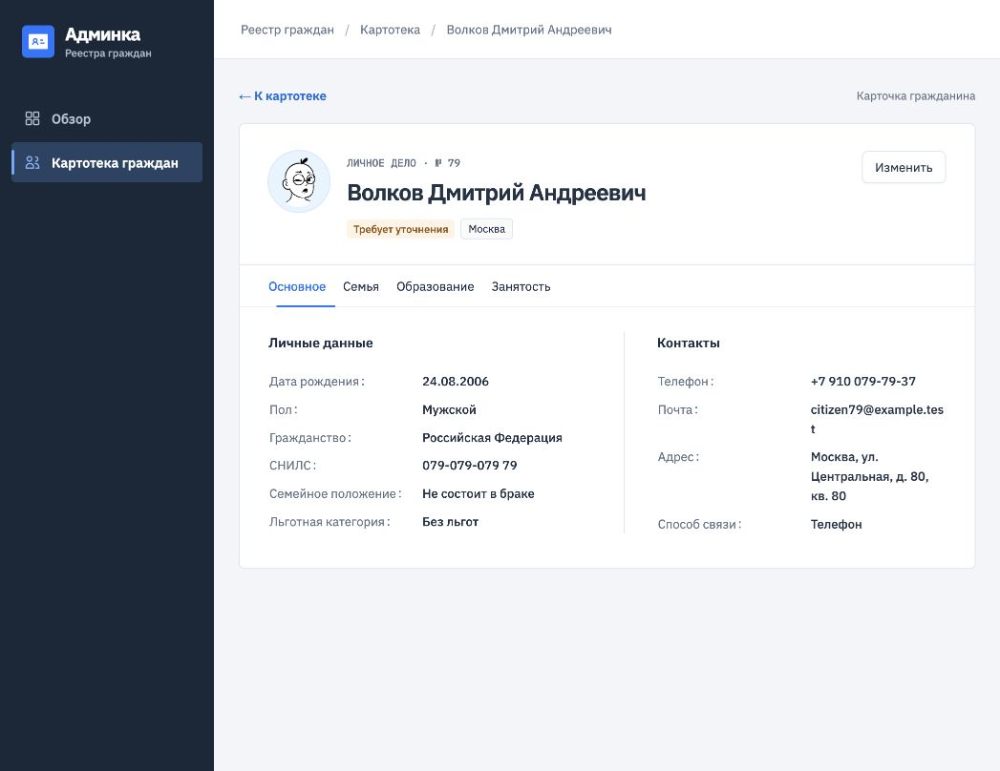

# Тестовое задание Frontend

## Задача

Создать современный интерфейс с главной страницей Dashboard и картотекой граждан **или** заявок help desk. Для картотеки нужны список с фильтрами и общим количеством записей, просмотр выбранной записи и разделы с подробной информацией. Формы должны включать разные виды полей и списков.

Интерфейс нужно проектировать с учётом возможного масштаба: более 100 000 записей, более 150 параметров и до 20 связанных таблиц. Это требование к подходу и поведению интерфейса, а не просьба вручную создать такой объём данных.

## Стек

- Обязательное: React и JavaScript или TypeScript. Выбран TypeScript.
- Для форм, таблицы и навигации используется Ant Design. Сборка — Vite.
- Аватары отображаются компонентом Ant Design `Avatar` с иллюстрациями DiceBear Lorelei. Если внешний сервис недоступен, вместо изображения показываются инициалы.
- Express и Docker в этом проекте не нужны и не используются.

## Что должно работать

1. Dashboard с несколькими показателями и графиками.
2. Картотека со списком, фильтрами и общим количеством записей.
3. Переход из списка на отдельную страницу гражданина `/citizens/:id` с разделами основных сведений, семьи, образования и занятости. Прямая ссылка и кнопки браузера «Назад»/«Вперёд» работают.
4. Разнообразные поля ввода и списки в формах.
5. Интерфейс списка, сохраняющий отзывчивость при большом количестве записей: данные для 120 000 демонстрационных граждан создаются по страницам, а фильтрация не создаёт 120 000 строк DOM.

Данные о гражданах можно создать самостоятельно. Структуру указанного в ТЗ портала следует переработать в современном стиле и другой компоновке. Примеры из PDF служат ориентирами по интерфейсу.

## Поля карточки

| Раздел | Параметры |
| --- | --- |
| Основное | ID, ФИО, дата рождения, пол, гражданство, СНИЛС, семейное положение, статус проверки, льготы |
| Контакты | Телефон, почта, регион, адрес, предпочитаемый способ связи |
| Семья | Член семьи, родство, дата рождения |
| Образование | Уровень, учебное заведение, год окончания, квалификация |
| Занятость | Профессия, формат занятости, организация, примечание |

Структура карточки разбита на вкладки, чтобы её можно было расширять до большого числа параметров и связанных таблиц. При возврате из карточки сохраняются фильтры и страница списка. В этой реализации демонстрационные данные генерируются на клиенте, без запросов к серверу; персональных данных реальных людей нет. Изменения основной карточки сохраняются локально в браузере (`localStorage`).

## Запуск

Нужны Node.js 22.12+ и npm. Из папки `frontend-fullstack-test`:

```bash
cd frontend
npm ci
npm run dev
```

Откройте `http://localhost:5174`. PostgreSQL и API для этого проекта не требуются. Если порт занят, Vite покажет другой адрес в терминале.

Проверка перед публикацией из папки `frontend/`:

```bash
npm run lint
npm run format:check
npm test
npm run build
```

Для автоматического форматирования исходников выполните `npm run format`. Prettier использует ширину строки 90 символов, двухпробельный отступ и переносит JSX-атрибуты на отдельные строки.

Если папка `frontend/` опубликована как отдельный Git-репозиторий, `npm ci` подключит Husky. Перед push он запустит `npm run format` и `npm run lint`. Если форматирование изменит отслеживаемые файлы, push остановится до нового коммита.

Собранные файлы появляются в `dist/`; они исключены из Git. Для локального просмотра сборки выполните `npm run preview`.

При размещении собранного приложения сервер должен отдавать `index.html` для маршрутов `/citizens` и `/citizens/:id`, чтобы прямые ссылки открывались после обновления страницы.

## Скриншоты




## Структура клиента

- `src/index.jsx` — единственный файл в корне `src`, точка входа приложения.
- `src/components/app/App.tsx` — корневой компонент; `src/style/` — переменные, общие и адаптивные SCSS-стили.
- `src/components/pages/` — `index.js` собирает экспорты; каждая страница находится в своей папке вместе со своим SCSS: `dashboardPage/`, `registryPage/`, `citizenDetailPage/`, `notFoundPage/`.
- `src/components/registryLayout/`, `citizenCard/`, `editCitizen/`, `backToRegistryLink/` — отдельные папки компонентов с их TSX и относящимися к ним SCSS.
- `src/hooks/useCitizenRegistry.ts` — состояние списка, переходы, фильтры и обработка сохранения.
- `src/services/` — генерация и выборка записей, чтение и запись в `localStorage`.
- `src/config/` — адреса страниц, разбор маршрута и состав фильтров.
- `src/models/` — типы гражданина и параметров поиска.
- `src/utils/` — форматирование данных для интерфейса.

Компоненты и страницы экспортируются по имени; тесты маршрутов и данных лежат рядом с соответствующими модулями.

## Перед сдачей

Проверить работу фильтров, выбора записи и форм; проверить интерфейс на разных размерах экрана; разместить результат в Git и предоставить ссылку.
